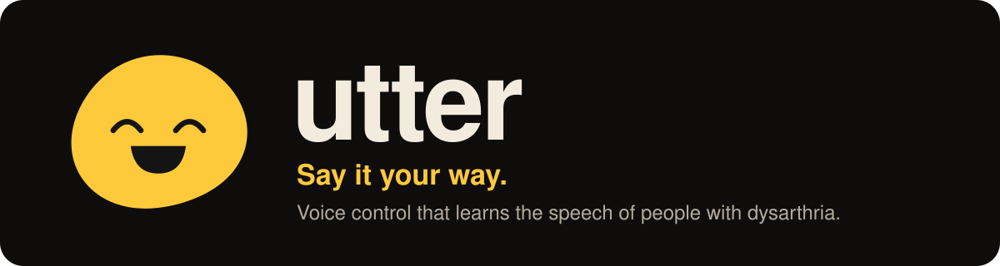
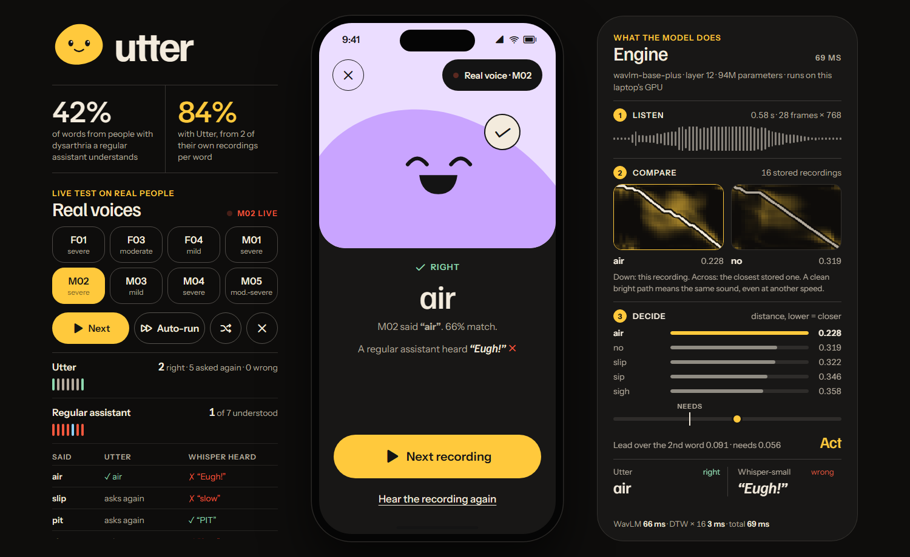
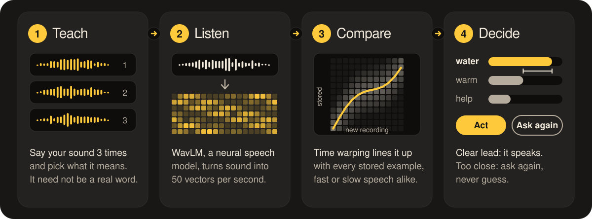
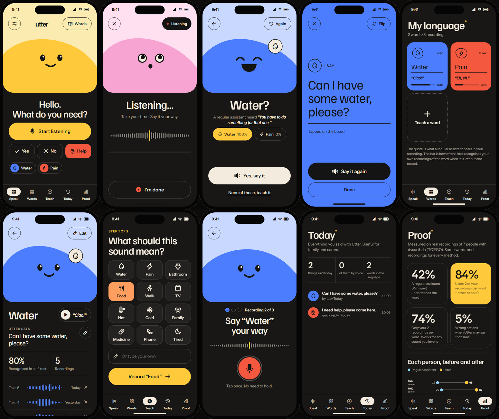

<p align="center"></p>

<p align="center">
<a href="https://colab.research.google.com/github/TomasZitko/utter/blob/main/notebooks/utter.ipynb"></a>
&nbsp;·&nbsp; <a href="https://tomaszitko.github.io/utter/"><b>Live project page</b></a>
&nbsp;·&nbsp; <a href="docs/writeup.md"><b>One-page write-up</b></a>
&nbsp;·&nbsp; <a href="notebooks/utter.ipynb">Notebook with outputs</a>
&nbsp;·&nbsp; <a href="docs/research.md">Research and sources</a>
</p>

**Utter app** · Jonáš, Tomáš and Benjamín · Veritas AI International High School Hackathon 2026 · Track: AI + Languages

People after a stroke, with Parkinson's, ALS or cerebral palsy often have **dysarthria**: speech that is slurred, slow or hard to understand. Many of them also can't use their hands well, so voice should be their way to control a phone, a smart home or a wheelchair. But standard speech recognition is trained on typical speech and often fails them: on real recordings, Whisper understands **42%** of their single words.

**Utter** turns the problem around. Instead of asking the person to speak like everyone else, it learns *their* way of saying things. You record a sound **three times**, tell Utter what it means, and from then on Utter recognises it and speaks the full sentence for you. When it isn't sure, it says so and asks again instead of guessing, because a wrong action is worse than no action.

| Regular speech recognition (Whisper) | **Utter** | Wrong actions with "not sure" on |
|:---:|:---:|:---:|
| 42% | **84%** | 5% |

*Single words from 7 people with dysarthria in the TORGO database, recordings the model never heard. Details and the weaker numbers are in [Results](#results).*

## See it work



*A real screenshot, not a mock-up. Left: **Real voices**, a live test on a real person with severe dysarthria from TORGO (speaker M02). The app was taught 8 of his words from 2 of his own recordings each and is now hearing recordings it has never heard; a regular assistant (Whisper) gets the same ones. Middle: the app. Right: the **Engine** panel shows what the model did with this recording: the frames it became, the time-warped alignment with the closest stored recording, the distance to every word, and the lead it needs before it acts. The score on the left is counted live, including the mistakes.*

## How it works, in one picture



The AI is the part that listens. [WavLM](https://huggingface.co/microsoft/wavlm-base-plus) is a neural network with about 95 million parameters that learned from unlabelled speech what speech sounds like. Utter uses it for few-shot learning: nothing is retrained, so two or three recordings of a word are enough. More detail is in [How it works](#how-it-works).

## The app



## Results

Tested on real recordings of **7 people with dysarthria** from the TORGO database. Each test gives the model a personal set of 8 words; the numbers are averages over people (50 random word sets each). Random guessing would be 12.5%.

| How the word is recognised | Correct |
|---|---|
| Regular speech recognition (Whisper small), generous matching | **42%** |
| Other people's recordings of the word only (no personalisation) | 79% |
| Only the person's own **2** recordings per word | 74% |
| **Utter: own 2 recordings + other people's recordings** | **84%** |

- **With "not sure" switched on**, Utter acts correctly 71% of the time, asks to repeat 24% of the time, and takes a wrong action only **5%** of the time. The threshold was set on *other* people with dysarthria.
- **The biggest gains are for the hardest-to-understand speakers.** For two people with severe dysarthria, Whisper got 20% of words and Utter 87%. For the person Whisper understood least, it got 12% of words and Utter 68%.
- **Sanity checks.** Whisper understands 73% of words from speakers *without* dysarthria, so the baseline works and the gap really comes from the speech. With shuffled labels, Utter drops to 10%, close to chance.

Charts: [each person](outputs/1_per_speaker.png), [how many recordings are enough](outputs/2_recordings_needed.png), [the "not sure" state](outputs/3_not_sure.png); the app draws the same charts live from `results.json` in its Proof tab. All numbers come from [`outputs/results.json`](outputs/results.json), written by the notebook. A fresh *Run all* in Google Colab (15 Nov 2026) reproduced every number in it exactly.

**Honest note.** For common English words, other people's recordings already help a lot (79%), more than 2 of the person's own (74%). Combining the two is best. Personal recordings matter where other people's fail. For F01, the speaker Whisper understood least (8%; F01 is only in the 1-recording test, see the notebook), one own recording per word beat other people's recordings (73% vs. 55%). They also matter where nobody else's recordings exist: sounds a person invents for themselves, like "wah-uh" for *water*. In that personal-only mode with "not sure" on, Utter acts correctly 54% of the time, asks again 41% of the time, and is wrong 5% of the time.

### The app, tested end to end on dysarthric speech

[`experiments/app_end_to_end.py`](experiments/app_end_to_end.py) drives the running app over HTTP, exactly like the browser does. For each person with dysarthria, it teaches 5 words with 3 of their own TORGO recordings each, then sends every remaining recording of those words to the app (10 random word sets per person). Only own recordings are used, as for invented sounds. Only 4 people have 5 words recorded at least 4 times.

| Person | Severity | Top guess correct | Utter acts (not "not sure") | Wrong actions |
|---|---|---|---|---|
| M04 | severe | 58% | 24% | 8% |
| M05 | moderate-severe | 86% | 64% | 2% |
| F03 | moderate | 75% | 44% | 4% |
| F04 | mild | 90% | 85% | 5% |
| **Mean** | | **77%** | **54%** | **5%** |

Chance is 20%. This is a small test (50–78 recordings per person), but it checks the whole app path: WAV upload, trimming, WavLM, DTW and the "not sure" threshold. Raw results: `experiments/app_end_to_end_results.csv`.

### Real voices, run for all 8 people

[`experiments/real_voices_test.py`](experiments/real_voices_test.py) repeats what the app's Real voices panel does, for every person and 6 random word sets each: the app learns 8 of the person's words from their own recordings only (2 per word; 1 for F01, who has too few repeats), then recognises every other recording of those words. Whisper transcribes the same recordings. 508 unheard recordings in total, run on 15 Nov 2026.

| Person | Severity | Top guess right | Acts right | Asks again | Acts wrong | Whisper right |
|---|---|---|---|---|---|---|
| F01 | severe | 75% | 56% | 36% | 7% | 11% |
| M01 | severe | 87% | 66% | 34% | 0% | 17% |
| M02 | severe | 73% | 55% | 40% | 5% | 24% |
| M04 | severe | 56% | 11% | 82% | 6% | 14% |
| M05 | moderate-severe | 74% | 53% | 43% | 4% | 46% |
| F03 | moderate | 57% | 31% | 64% | 6% | 50% |
| F04 | mild | 77% | 66% | 31% | 3% | 59% |
| M03 | mild | 91% | 83% | 15% | 2% | 70% |
| **Mean** | | **74%** | **53%** | **43%** | **4%** | **36%** |

This is the own-recordings-only setting, so it matches the notebook's own-only numbers (74% top guess; 54% right, 41% asks again, 5% wrong), not the 84% of the combined model. It is honest about the hard cases: for M04 the app mostly asks again instead of acting. The median recognition time was 89 ms on a laptop GPU. Raw results: `experiments/real_voices_results.csv`.

### The app's screens, tested with a fake microphone

[`experiments/ui_selftest.js`](experiments/ui_selftest.js) drives the real app in the browser and replaces the microphone with real recordings. It teaches a word with three recordings, checks that recording stops by itself, says the word, confirms it, checks the spoken sentence, the log, editing, removing a recording, Czech, the settings and the guide, and then forgets the temporary word. On 15 Nov 2026 all 24 checks passed.

## How it works

1. **Fingerprints.** A small pre-trained speech model, [WavLM Base+](https://huggingface.co/microsoft/wavlm-base-plus), turns each recording into a sequence of vectors (50 per second). We use layer 12, chosen on speakers *without* dysarthria only.
2. **Matching.** A new recording is compared with every stored example using **dynamic time warping (DTW)** on these vectors. The word with the closest example wins.
3. **"Not sure".** If the best word is only slightly closer than the second best, Utter asks the person to repeat. The threshold is set so that at most 5% of actions are wrong, calibrated on *other* people with dysarthria (never on the person being tested).
4. **Learning from use.** When the person confirms a guess, the recording is added as another example.

Utter's main model combines the person's own recordings with recordings of the same word by other people, when those exist. For sounds the person invents (for example "wah-uh" meaning *water*), only their own recordings exist. That's why we also report the personal-only number.

## Data

**TORGO database of dysarthric speech**: Rudzicz, F., Namasivam, A. K., Wolff, T. (2012). *The TORGO database of acoustic and articulatory speech from speakers with dysarthria.* Language Resources and Evaluation 46(4), 523–541. We used the copy on Hugging Face: [`abnerh/TORGO-database`](https://huggingface.co/datasets/abnerh/TORGO-database).

- 8 speakers with dysarthria (cerebral palsy or ALS) and 7 without, English, lab recordings.
- We use **single-word recordings only**, one copy per recording (TORGO records each utterance with two microphones at once, and we keep only one), and only words the person said at least twice. That leaves 2,952 recordings of 136 words.
- The data is **not** in this repository. The notebook downloads it.

**Why a set of 8 words and not just the 10 commands (yes, no, up…)?** In this version of TORGO, people with dysarthria recorded each command only 1–4 times, mostly once. That's not enough to train on some and test on the rest. So we simulate a personal set of commands: for each person we repeatedly pick 8 single words they recorded several times, train on 1–3 recordings per word, and test on the rest. Results are averaged over 50 random picks.

## Baselines

- **Whisper** (`openai/whisper-small`), the regular speech recognition a voice assistant would use. It counts as correct if the word, or a homophone (knew/new, four/for/4…), appears anywhere in its transcript. That's generous to Whisper.
- **Other people only**: the same DTW matching, but with up to 10 recordings of the same word by other speakers instead of the person's own. No personalisation.

## How we kept the evaluation honest

- **No leakage between microphones**: each recording appears once.
- **No tuning on the test people**: the model layer, the method (DTW vs. averaged fingerprint, combination) and the threshold were chosen on speakers without dysarthria, or on *other* people with dysarthria.
- **Shuffled-label check**: with randomly shuffled word labels, accuracy drops to chance (10% vs. 12.5% chance). The model really learns the words.
- **Duplicate check**: we hash all audio; one duplicate pair exists (in a healthy speaker) and doesn't affect people with dysarthria.

## What we tried (including what didn't work)

| Change | Tested on | Result | Kept? |
|---|---|---|---|
| Averaged WavLM fingerprint + nearest centroid (first version) | speakers without dysarthria | 60–64% | no |
| DTW on the whole sequence of fingerprints, layers 3/6/9/12 | speakers without dysarthria | 69–72% (k=1), 80–82% (k=2); layer 12 best | **yes** |
| DTW with per-recording mean subtraction (CMN) | 2 speakers without dysarthria (stopped early) | worse at every layer (e.g. FC02, layer 12, k=2: 77% vs 81%) | no |
| Combine own + other people's recordings | speakers without dysarthria | 89–91% vs 72–86% own-only, 75–83% others-only | **yes** |
| Whisper text matching without homophones | – | Whisper scored only 64% on healthy speakers, mostly homophones (knew → "new") | fixed: homophones count as correct |

Scripts: [`experiments/phase2_dtw.py`](experiments/phase2_dtw.py), [`experiments/phase2b_hybrid.py`](experiments/phase2b_hybrid.py), results in `experiments/*.csv`.

## Run it

### The analysis (notebook)
- **Colab:** [open the notebook in Colab](https://colab.research.google.com/github/TomasZitko/utter/blob/main/notebooks/utter.ipynb), *Runtime → Change runtime type → T4 GPU*, then *Runtime → Run all* (about 30–60 minutes).
- **Locally (Windows/Mac/Linux, Python 3.11):**
  ```bash
  python -m venv .venv
  .venv\Scripts\activate            # Mac/Linux: source .venv/bin/activate
  pip install -r requirements.txt
  cd notebooks
  jupyter nbconvert --to notebook --execute --inplace utter.ipynb
  ```
  Outputs go to `outputs/` (`results.json`, charts, example recordings), data and caches to `data/`.

### The app
Requires `outputs/results.json` from the notebook (it is in the repository).
```bash
.venv\Scripts\python -m uvicorn app.server:app --port 8000
```
Open http://localhost:8000 and allow the microphone. Everything runs on your computer: the browser records 16 kHz WAV directly (no ffmpeg needed) and the server runs WavLM (and Whisper, to show what a regular assistant would hear). Taught words are saved in `data/app_state/`. Browsers allow the microphone only on `localhost` or HTTPS, so to try it on a phone, open it through an HTTPS tunnel or deploy it with HTTPS.

**What is in the app**

- **Speak**: tap once (or press Space), say your sound, and listening stops by itself when you stop. Utter shows its guess and what a regular assistant heard; nothing is spoken until you confirm. Then it says the full sentence aloud on a screen you can flip towards the listener.
- **Not sure**: when the best word is not clearly ahead, Utter asks again instead of acting. In Settings you choose how careful it should be (Careful / Balanced / Quick); Balanced is the threshold measured in the notebook.
- **Tap to say**: every taught word is also one tap away, for the days when the voice doesn't work. **Yes / No / Help** are always there; Help also sounds an alarm.
- **Words**: your personal language. For each word: what a regular assistant hears in it, how often Utter recognises it in a self-test, every recording (play, remove), and the sentence it says (editable).
- **Teach**: pick a meaning or type your own, record it 3 times. It doesn't have to be a word.
- **Today**: a log of everything said, with the time, for family and carers.
- **Proof**: the measured results, drawn live from `outputs/results.json`, and real recordings to listen to.
- **Guide**: on first start Blub explains the app in five short steps; it can be reopened from the profile.
- **Profile and settings**: name, language of the app and the voice (**English and Czech**; recognition itself has no language, it matches sounds), the voice and its speed, how careful Utter is, stop by itself, ask before speaking, learn from confirmed guesses, and a still mode without motion.
- **Blub**, the mascot and logo, shows what the app is doing: listening (the mouth follows the real loudness), thinking, happy, not sure, and asleep when nothing happens.
- **Engine panel** (desktop): for every recording, the real internals of the decision: frames, DTW alignment, distance to each word, lead vs. threshold, and the time it took (about 0.1–0.3 s on a small laptop GPU).
- **Real voices** (desktop): the live test described above. It needs the TORGO recordings locally; build the pack once with `python experiments/build_demo_pack.py` (after the notebook has downloaded the data to `data/raw/`). It mirrors the notebook's own-recordings-only setting: 8 words, 2 own recordings per word, tested on that person's other recordings. Without the pack the rest of the app works the same.
- **Switch access**: the Space key starts and stops listening and recording. Bad recordings and forgotten words are moved to an archive folder, never deleted.

The design (Blub the mascot, who is also the logo; Familjen Grotesk + Instrument Sans; Phosphor icons) is in [`design/`](design/). Its tokens live in `app/static/tokens.css`, Blub in `brand.js`.

## Limits

- Only **8 people** with dysarthria (7 for the main number: one person has too few repeated words).
- **English** only, **single words** only, **lab recordings**, not a noisy home.
- TORGO's speakers have cerebral palsy or ALS; we didn't test people after a stroke or with Parkinson's.
- We simulate a set of 8 words; real use may need more words or longer phrases.
- The app was tested end to end with TORGO recordings (above) and live by us, but not yet live by people with dysarthria.

## Next steps

Czech (and other languages: the method doesn't depend on language), tests with real users and their speech therapists, more words and short phrases, and a phone app that runs fully on the device.

## Repository

```
notebooks/utter.ipynb       analysis, saved with outputs (runs in Google Colab)
outputs/                    results.json and charts
app/server.py               FastAPI backend
app/static/                 frontend (plain HTML/CSS/JS): app.js (phone app), engine.js (model panel),
                            lab.js (Real voices), charts.js, brand.js + tokens.css (design language)
design/                     app design
experiments/                method comparison on speakers without dysarthria, app tests on TORGO and
                            in the browser, build_demo_pack.py (recordings for Real voices)
docs/                       project page (GitHub Pages), write-up, research with sources, video script
video/                      source of the launch film (Remotion)
```

## Sources and credits

- **Data:** TORGO database of dysarthric speech, Rudzicz, Namasivam & Wolff (2012), *Language Resources and Evaluation* 46(4), 523–541; the copy on Hugging Face, [`abnerh/TORGO-database`](https://huggingface.co/datasets/abnerh/TORGO-database). No other dataset is used.
- **Pretrained models:** [`microsoft/wavlm-base-plus`](https://huggingface.co/microsoft/wavlm-base-plus) (the model Utter listens with) and [`openai/whisper-small`](https://huggingface.co/openai/whisper-small) (the baseline).
- **Libraries:** PyTorch, Hugging Face Transformers and Datasets, Numba, scikit-learn, pandas, Matplotlib, FastAPI. The film in `video/` is built with Remotion.
- **Design:** our own (Blub, the mascot and logo). Icons: [Phosphor](https://phosphoricons.com). Fonts: Familjen Grotesk and Instrument Sans from Google Fonts.
- **Background facts** (how common dysarthria is, how speech recognition does on atypical speech, existing tools): every claim has its source in [docs/research.md](docs/research.md).
- **AI tools:** [Claude Code](https://claude.com/claude-code) as the coding assistant (code, tests, texts); [Claude](https://claude.ai), [ChatGPT](https://chatgpt.com), [Gemini](https://gemini.google.com) and [Perplexity](https://www.perplexity.ai) for research, ideas and checking explanations.

Utter is a prototype built in one weekend. It is not a medical device and not medical advice.

## License

Code: MIT. TORGO data is not included and is subject to its own terms. WavLM and Whisper are used under their respective licenses (MIT).
