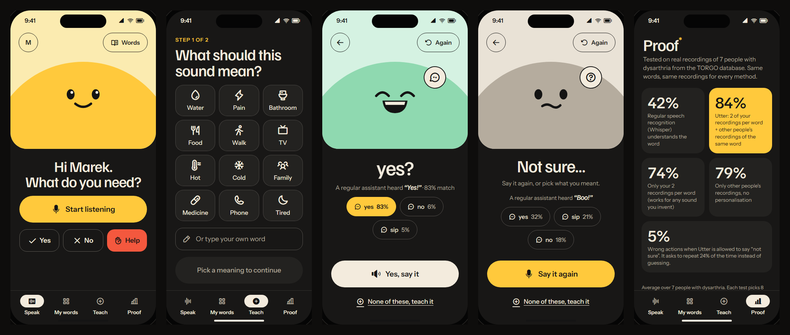
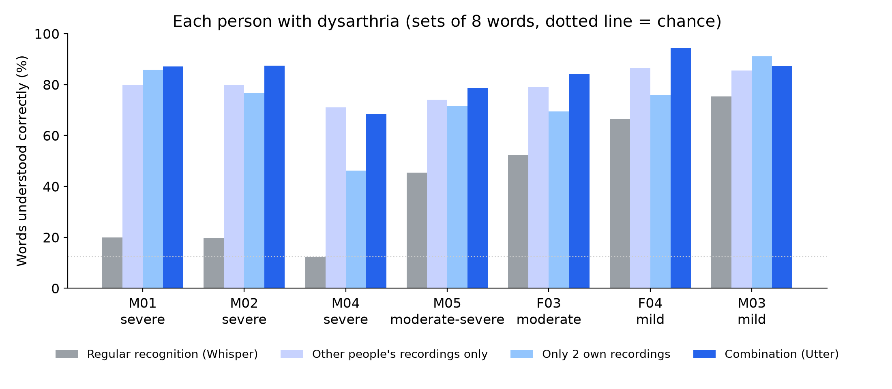

# Utter: voice control that learns *your* speech

**Team Slyším tě** (Tomáš + Jonáš) · Veritas AI Hackathon 2026 · Track: AI + Languages

People after a stroke, with Parkinson's, ALS or cerebral palsy often have **dysarthria**: speech that is slurred, slow or hard to understand. Many of them also can't use their hands well, so voice should be their way to control a phone, a smart home or a wheelchair. But standard speech recognition is trained on typical speech and often fails them.

**Utter** turns the problem around. Instead of asking the person to speak like everyone else, it learns *their* way of saying things. You record a sound **three times**, tell Utter what it means, and from then on Utter recognises it and speaks the full sentence for you. When it isn't sure, it says so and asks again instead of guessing, because a wrong action is worse than no action.

[](https://colab.research.google.com/github/TomasZitko/slysim-te/blob/main/notebooks/slysim_te.ipynb) [**Open the analysis in Google Colab**](https://colab.research.google.com/github/TomasZitko/slysim-te/blob/main/notebooks/slysim_te.ipynb) · [One-page write-up](docs/writeup.md) · [Research and sources](docs/research.md)



*Real app screens. For the middle two, the app was taught 5 words with 3 TORGO recordings each from speaker M05 (moderate-severe dysarthria). Each was then given a recording it had never heard. In the first, "yes" is recognised. In the second, the recording was "tear", Utter's best guess was wrong, and so it said "Not sure" instead of acting.*

## Results

Tested on real recordings of **7 people with dysarthria** from the TORGO database. Each test gives the model a personal set of 8 words; the numbers are averages over people (50 random word sets each). Random guessing would be 12.5%.

| How the word is recognised | Correct |
|---|---|
| Regular speech recognition (Whisper small), generous matching | **42%** |
| Other people's recordings of the word only (no personalisation) | 79% |
| Only the person's own **2** recordings per word | 74% |
| **Utter: own 2 recordings + other people's recordings** | **84%** |

- **With "not sure" switched on**, Utter acts correctly 71% of the time, asks to repeat 24% of the time, and takes a wrong action only **5%** of the time. The threshold was set on *other* people with dysarthria.
- **The biggest gains are for the hardest-to-understand speakers.** For two people with severe dysarthria, Whisper got 20% of words and Utter 87%. For the person Whisper understood least, it got 12% of words and Utter 68%.
- **Sanity checks.** Whisper understands 73% of words from speakers *without* dysarthria, so the baseline works and the gap really comes from the speech. With shuffled labels, Utter drops to 10%, close to chance.



More charts: [how many recordings are enough](outputs/2_recordings_needed.png), [the "not sure" state](outputs/3_not_sure.png). All numbers come from [`outputs/results.json`](outputs/results.json), written by the notebook.

**Honest note.** For common English words, other people's recordings already help a lot (79%), more than 2 of the person's own (74%). Combining the two is best. Personal recordings matter where other people's fail. For F01, the speaker Whisper understood least (8%; F01 is only in the 1-recording test, see the notebook), one own recording per word beat other people's recordings (73% vs. 55%). They also matter where nobody else's recordings exist: sounds a person invents for themselves, like "wah-uh" for *water*. In that personal-only mode with "not sure" on, Utter acts correctly 54% of the time, asks again 41% of the time, and is wrong 5% of the time.

### The app, tested end to end on dysarthric speech

[`experiments/app_end_to_end.py`](experiments/app_end_to_end.py) drives the running app over HTTP, exactly like the browser does. For each person with dysarthria, it teaches 5 words with 3 of their own TORGO recordings each, then sends every remaining recording of those words to the app (10 random word sets per person). Only own recordings are used, as for invented sounds. Only 4 people have 5 words recorded at least 4 times.

| Person | Severity | Top guess correct | Utter acts (not "not sure") | Wrong actions |
|---|---|---|---|---|
| M04 | severe | 58% | 24% | 8% |
| M05 | moderate-severe | 86% | 64% | 2% |
| F03 | moderate | 75% | 44% | 4% |
| F04 | mild | 90% | 85% | 5% |
| **Mean** | | **77%** | **54%** | **5%** |

Chance is 20%. This is a small test (50–78 recordings per person), but it checks the whole app path: WAV upload, trimming, WavLM, DTW and the "not sure" threshold. Raw results: `experiments/app_end_to_end_results.csv`.

## How it works

1. **Fingerprints.** A small pre-trained speech model, [WavLM Base+](https://huggingface.co/microsoft/wavlm-base-plus), turns each recording into a sequence of vectors (50 per second). We use layer 12, chosen on speakers *without* dysarthria only.
2. **Matching.** A new recording is compared with every stored example using **dynamic time warping (DTW)** on these vectors. The word with the closest example wins.
3. **"Not sure".** If the best word is only slightly closer than the second best, Utter asks the person to repeat. The threshold is set so that at most 5% of actions are wrong, calibrated on *other* people with dysarthria (never on the person being tested).
4. **Learning from use.** When the person confirms a guess, the recording is added as another example.

Utter's main model combines the person's own recordings with recordings of the same word by other people, when those exist. For sounds the person invents (for example "wah-uh" meaning *water*), only their own recordings exist. That's why we also report the personal-only number.

## Data

**TORGO database of dysarthric speech**: Rudzicz, F., Namasivam, A. K., Wolff, T. (2012). *The TORGO database of acoustic and articulatory speech from speakers with dysarthria.* Language Resources and Evaluation 46(4), 523–541. We used the copy on Hugging Face: [`abnerh/TORGO-database`](https://huggingface.co/datasets/abnerh/TORGO-database).

- 8 speakers with dysarthria (cerebral palsy or ALS) and 7 without, English, lab recordings.
- We use **single-word recordings only**, one copy per recording (TORGO records each utterance with two microphones at once, and we keep only one), and only words the person said at least twice. That leaves 2,952 recordings of 136 words.
- The data is **not** in this repository. The notebook downloads it.

**Why a set of 8 words and not just the 10 commands (yes, no, up…)?** In this version of TORGO, people with dysarthria recorded each command only 1–4 times, mostly once. That's not enough to train on some and test on the rest. So we simulate a personal set of commands: for each person we repeatedly pick 8 single words they recorded several times, train on 1–3 recordings per word, and test on the rest. Results are averaged over 50 random picks.

## Baselines

- **Whisper** (`openai/whisper-small`), the regular speech recognition a voice assistant would use. It counts as correct if the word, or a homophone (knew/new, four/for/4…), appears anywhere in its transcript. That's generous to Whisper.
- **Other people only**: the same DTW matching, but with up to 10 recordings of the same word by other speakers instead of the person's own. No personalisation.

## How we kept the evaluation honest

- **No leakage between microphones**: each recording appears once.
- **No tuning on the test people**: the model layer, the method (DTW vs. averaged fingerprint, combination) and the threshold were chosen on speakers without dysarthria, or on *other* people with dysarthria.
- **Shuffled-label check**: with randomly shuffled word labels, accuracy drops to chance (10% vs. 12.5% chance). The model really learns the words.
- **Duplicate check**: we hash all audio; one duplicate pair exists (in a healthy speaker) and doesn't affect people with dysarthria.

## What we tried (including what didn't work)

| Change | Tested on | Result | Kept? |
|---|---|---|---|
| Averaged WavLM fingerprint + nearest centroid (first version) | speakers without dysarthria | 60–64% | no |
| DTW on the whole sequence of fingerprints, layers 3/6/9/12 | speakers without dysarthria | 69–72% (k=1), 80–82% (k=2); layer 12 best | **yes** |
| DTW with per-recording mean subtraction (CMN) | 2 speakers without dysarthria (stopped early) | worse at every layer (e.g. FC02, layer 12, k=2: 77% vs 81%) | no |
| Combine own + other people's recordings | speakers without dysarthria | 89–91% vs 72–86% own-only, 75–83% others-only | **yes** |
| Whisper text matching without homophones | – | Whisper scored only 64% on healthy speakers, mostly homophones (knew → "new") | fixed: homophones count as correct |

Scripts: [`experiments/phase2_dtw.py`](experiments/phase2_dtw.py), [`experiments/phase2b_hybrid.py`](experiments/phase2b_hybrid.py), results in `experiments/*.csv`.

## Run it

### The analysis (notebook)
- **Colab:** open the link above, *Runtime → Change runtime type → T4 GPU*, then *Runtime → Run all* (about 30–60 minutes).
- **Locally (Windows/Mac/Linux, Python 3.11):**
  ```bash
  python -m venv .venv
  .venv\Scripts\activate            # Mac/Linux: source .venv/bin/activate
  pip install -r requirements.txt
  cd notebooks
  jupyter nbconvert --to notebook --execute --inplace slysim_te.ipynb
  ```
  Outputs go to `outputs/` (`results.json`, charts, example recordings), data and caches to `data/`.

### The app (Utter)
Requires `outputs/results.json` from the notebook.
```bash
.venv\Scripts\python -m uvicorn app.server:app --port 8000
```
Open http://localhost:8000 and allow the microphone. Everything runs on your computer: the browser records 16 kHz WAV directly (no ffmpeg needed) and the server runs WavLM (and Whisper, to show what a regular assistant would hear). Taught words are saved in `data/app_state/`.

Screens: **Speak** (listen → guess → confirm → Utter says the sentence), **My words**, **Teach** (pick a meaning, record 3×), and **Proof** (results on TORGO, real examples where Whisper failed). Nothing is spoken until the person confirms. Bad recordings can be removed in the word's detail (they're moved to an archive folder, not deleted). For switch users, the **Space** key starts and stops listening and recording. Design: [`design/Utter App.dc.html`](design/).

## Limits

- Only **8 people** with dysarthria (7 for the main number: one person has too few repeated words).
- **English** only, **single words** only, **lab recordings**, not a noisy home.
- TORGO's speakers have cerebral palsy or ALS; we didn't test people after a stroke or with Parkinson's.
- We simulate a set of 8 words; real use may need more words or longer phrases.
- The app was tested end to end with TORGO recordings (above) and live by us, but not yet live by people with dysarthria.

## Next steps

Czech (and other languages: the method doesn't depend on language), tests with real users and their speech therapists, more words and short phrases, and a phone app that runs fully on the device.

## Repository

```
notebooks/slysim_te.ipynb   analysis, saved with outputs
outputs/                    results.json and charts
app/server.py               FastAPI backend
app/static/                 frontend (plain HTML/CSS/JS), design tokens in tokens.css
design/                     app design
experiments/                method comparison on speakers without dysarthria, app end-to-end test
docs/                       write-up, research with sources, video script, screenshots
```

## License

Code: MIT. TORGO data is not included and is subject to its own terms. WavLM and Whisper are used under their respective licenses (MIT).
